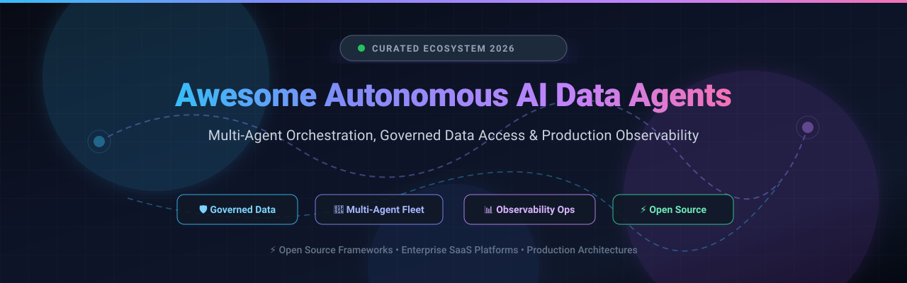

# 🤖 Awesome Autonomous AI Data Agents

  

  
  
  
  
  
  

  <strong>🌟 Curated Directory of Enterprise SaaS Platforms &amp; Open-Source Frameworks for Autonomous AI Data Agents 🌟</strong> 
  <em>Focused on Multi-Agent Orchestration, Governed Data Access, Enterprise Workflow Automation &amp; Production Observability</em> 
  <strong>Last updated: October 2026</strong>

---

## 📌 Table of Contents

- [🌐 Overview &amp; Ecosystem Scope](#-overview--ecosystem-scope)
- [📊 Sector Overview &amp; Market Dynamics](#-sector-overview--market-dynamics)
- [🏢 SaaS &amp; Hosted Platforms](#-saas--hosted-platforms)
- [💻 Open-Source GitHub Projects](#-open-source-github-projects)
- [🛠️ Additional Specialized Tools &amp; Integrations](#️-additional-specialized-tools--integrations)
- [🤝 How to Contribute](#-how-to-contribute)
- [💖 Support &amp; Sponsorship](#-support--sponsorship)
- [📈 Star History](#-star-history)
- [⚖️ Disclaimer](#️-disclaimer)

---

## 🌐 Overview &amp; Ecosystem Scope

This repository tracks notable **enterprise SaaS platforms** and **open-source frameworks** for **Autonomous AI Data Agents**. These next-generation systems transition teams from simple chat copilots to goal-driven autonomous agents capable of reasoning over structured data warehouses, orchestrating multi-step workflows across disparate APIs, and executing high-consequence operations with governed access controls and human-in-the-loop oversight.

### 🔍 Key Capabilities Evaluated
* **🛡️ Governed Data Access:** Native semantic layers, row-level access control, and strict perimeter boundaries (e.g., Snowflake Cortex).
* **🤖 Multi-Agent Orchestration:** Role-based team delegation (CrewAI), stateful cyclic graphs (LangGraph), and multi-agent debate (AutoGen/ChatDev).
* **📊 Observability &amp; Telemetry:** Tracing span trees, agent action auditing, cost attribution, and hallucination monitoring (AgentOps).
* **🌐 Web &amp; Tool Grounding:** Dynamic browser navigation, live data extraction, and Model Context Protocol (MCP) tool integration.

---

## 📊 Sector Overview &amp; Market Dynamics

> 💡 **Market Size &amp; Trajectory:** The global Autonomous AI Agents market is valued at approximately **$5.9 Billion to $7.8 Billion in 2025–2026** and is projected to surge past **$52 Billion by 2030**, advancing at a hyper-growth Compound Annual Growth Rate (**CAGR of 41% to 46%**).
>
> ⚡ **Market Concentration &amp; Dynamics:** The sector is **moderately fragmented at the application and orchestration framework layer**—where open-source tools like CrewAI, LangGraph, and AutoGPT foster diverse developer approaches—yet **highly concentrated and winner-take-all at the governed data plane and compute infrastructure layers**, where cloud data platform giants (Snowflake, Databricks, AWS, Microsoft) leverage proprietary enterprise data gravity and compliance moats.

---

## 🏢 SaaS &amp; Hosted Platforms

The following SaaS and managed commercial platforms provide out-of-the-box infrastructure, data governance, and autonomous execution environments. Entries are sorted descending by **Company Scale / Valuation / Revenue**.

| Platform | Company Scale / Valuation / Revenue | Overview &amp; Key Capabilities | Starting Pricing | Free Tier / Trial Limits | Best For / Trade-offs |
| :--- | :--- | :--- | :--- | :--- | :--- |
| **[Snowflake Cortex Agents](https://www.snowflake.com/)** | **~$110B+ Market Cap** (Public: NYSE: SNOW; ~$3B+ ARR) | Governed data agent platform inside Snowflake AI stack. Employs a 6-step loop, Cortex Analyst (text-to-SQL over semantic views), Cortex Search (unstructured docs), and MCP connectors (Jira, Salesforce). Enforces row-level policies and guardrails within Snowflake perimeter. | **$2.00 / credit** (Standard Edition On-Demand; Enterprise at $3.00/credit) | **30-day free trial with $400 usage credits** (requires upgrade to on-demand after 30 days or credit exhaustion; no permanent free tier) | **Best for:** Enterprises with mature Snowflake deployments wanting governed data access. **Trade-off:** High dependency on Snowflake adoption and data readiness. |
| **[Cognition Devin](https://cognition.com/)** | **$48B Valuation** (Raised $2B+; ~$900M run-rate revenue) | Autonomous software engineering agent teammate. Capabilities include Auto-Triage (incident investigation), Security Swarm (vulnerability triage), and workflow automations triggered by Slack, GitHub, or Linear. | **$20 / month** (Pro Tier; Max at $200/mo; Teams at $80 base + $40/seat/mo; Enterprise with ACUs via custom quote) | **Free Plan ($0/mo)**: Light agent coding quota, limited model access, unlimited inline edits and tab completions (no persistent cloud agent compute) | **Best for:** Autonomous coding and engineering operations at scale. **Trade-off:** Premium cost; autonomous software engineering remains an evolving domain. |
| **[LangGraph Cloud / Platform](https://www.langchain.com/langgraph)** | **~$1.25B Valuation** (LangChain; raised $260M total) | Hosted agent deployment and orchestration infrastructure within LangSmith. Provides managed serverless infrastructure, state checkpointing, and human-in-the-loop streaming. | **$39.00 / user / month** (LangSmith Plus includes 1 free Small Serverless deployment; metered compute/memory beyond) | **Free Developer Plan**: **5,000 traces / month** and 1 seat for prototyping (managed cloud serverless deployments require paid Plus plan) | **Best for:** Stateful, cyclic graph agents built with LangGraph needing managed deployment and checkpointing. **Trade-off:** Requires LangSmith subscription for production hosting. |
| **[MultiOn](https://www.multion.ai/)** | **~$100M Valuation** (Raised $20M+ led by General Catalyst) | Autonomous web browsing agent API enabling agents to navigate websites, complete web forms, and extract live data via natural language. Integrates into CrewAI via MultiOnTool. | **$20.00 / month** (Pro Tier; API consumption billed at ~$0.01 per action / session-based billing) | **Free Tier**: **50 free actions/credits per month** (or up to 10 daily test requests on playground/developer sandbox) | **Best for:** Workflows needing autonomous web browsing, search, and dynamic web action execution. **Trade-off:** Specialized in browser automation; not a general enterprise data platform. |
| **[Lindy AI](https://www.lindy.ai/)** | **~$50M+ Valuation est.** (Early-stage venture-backed by a16z &amp; Battery) | AI teammate for business operations handling email, meeting prep, scheduling, reports, dashboards, and CRM updates. Cross-task compounding context, SOC 2 Type II, GDPR, HIPAA compliant with human-in-the-loop approval gates. | **$29.99 / user / month** (Plus/Team Tier with 3,000 pooled credits; top-ups at $10 per 1,000 credits) | **7-day free trial with $50 worth of free credits** (no credit card required; access expires after 7 days or credit depletion; no permanent free tier) | **Best for:** Teams needing general operational workflow and report automation. **Trade-off:** Not specialized for deep data engineering or code compilation. |
| **[AgentOps](https://www.agentops.ai/)** | **~$15M Valuation est.** (Seed; raised $2.6M+ pre-seed) | Agent observability and operations platform with auto-instrumentation for OpenAI, LangChain, CrewAI, and AutoGen capturing LLM calls, tool execution, and session cost tracking. | **$40.00 / month** (Pro Tier with pay-as-you-go event overages; Enterprise via custom quote) | **Free Forever Tier**: **10,000 events / month**, core session tracking, framework integrations, and basic telemetry log retention | **Best for:** Production tracing, debugging, and cost monitoring across multi-agent workflows. **Trade-off:** Observability layer only; does not build or orchestrate agents. |
| **[CrewAI AMP Suite](https://www.crewai.com/)** | **Series A venture-backed** (Commercial spinout of CrewAI OSS) | Commercial enterprise management, deployment, observability, and governance suite layered on top of the open-source CrewAI framework. | **$0 / month** (AMP Basic; Enterprise starts via custom quote sized to workload) | **Free Plan (AMP Basic)**: **50 workflow executions / month**, visual editor, and GitHub integration (open-source Python library is 100% free under MIT) | **Best for:** Teams deploying role-based CrewAI agents needing enterprise governance, deployment, and tracing. **Trade-off:** Commercial suite separate from open-source library; users provide their own LLM API keys. |
| **[Fixie.ai](https://fixie.ai/)** *(Acquired / Defunct)* | **Acquired by Inworld AI** (Raised $17M seed in 2023) | Original platform for building and wiring natural language LLM agents with tools. Pivoted to Ultravox (speech-native voice model) and acquired by Inworld AI in September 2026; fixie.ai redirects to ultravox.ai. | **Historical: $0.00** developer tier / API consumption (Acquired by Inworld AI; standalone product discontinued) | **Historical developer limit**: 1,000 free agent calls / day during developer preview; current Ultravox has limited free minutes sandbox | **Historical reference only** — do not build new projects on this platform. |
| **[Adept](https://www.adept.ai/)** *(Defunct / Inactive)* | **Raised $350M** (Core team &amp; IP licensed to Amazon in 2024) | ML lab for computer interaction and action models (ACT-1). Core team and IP absorbed/licensed by Amazon in 2024. Standalone operations effectively closed. | **Historical: Pilot-only** (Never launched a public self-serve SaaS tier; closed enterprise pilot access only) | **Historical limit**: Closed enterprise pilot access only; no public free tier or trials | **Historical reference only** — do not build on this platform. |

---

## 💻 Open-Source GitHub Projects

Curated open-source frameworks for self-hosted multi-agent orchestration, autonomous data exploration, and agentic workflows. **Sorted descending by GitHub Star Count**.

### 1. **[Significant-Gravitas/AutoGPT](https://github.com/Significant-Gravitas/AutoGPT)** 
* **Description:** The pioneering autonomous AI agent framework designed to break down high-level objectives into autonomous sub-tasks, browse the web, execute terminal commands, and persist long-term memory.
* **License:** MIT | **Tech Stack:** Python, TypeScript, Docker
* **Key Features:** Graphical agent builder, modular benchmark harness (`agbenchmark`), multi-agent communication protocols, and rich plugin ecosystem.
* **Trade-off:** High LLM token consumption in unconstrained execution loops; requires carefully tuned stopping conditions for production workloads.
* **Best for:** Prototyping autonomous general-purpose agents and benchmarking agent planning algorithms.

### 2. **[browser-use/browser-use](https://github.com/browser-use/browser-use)** 
* **Description:** Open-source web-browsing agent library enabling AI agents to interact with websites seamlessly using browser automation and multimodal computer vision.
* **License:** MIT | **Tech Stack:** Python, Playwright
* **Key Features:** Full DOM tree parsing, multi-tab navigation, element coordinate detection, CAPTCHA handling support, and seamless integration with LangChain / CrewAI.
* **Trade-off:** Dependent on webpage layout stability and browser execution latency.
* **Best for:** Autonomous data extraction, automated web scraping, form submission, and QA verification.

### 3. **[geekan/MetaGPT](https://github.com/geekan/MetaGPT)** 
* **Description:** Multi-agent meta-programming framework incorporating Standard Operating Procedures (SOPs) to coordinate simulated software development teams (Product Managers, Architects, Engineers, QA).
* **License:** MIT | **Tech Stack:** Python
* **Key Features:** Role-specific SOP assignment, structured output schemas, software design diagram generation (PRDs, system architecture diagrams), and automated code generation.
* **Trade-off:** Rigid sequential SOPs can be less adaptable for open-ended, non-software analytical tasks.
* **Best for:** End-to-end software specifications, code architecture drafting, and rigorous role-based multi-agent collaboration.

### 4. **[crewAIInc/crewAI](https://github.com/crewAIInc/crewAI)** 
* **Description:** Production-ready framework for orchestrating collaborative autonomous AI agents with rich role backstories, task delegation, and unified memory management.
* **License:** MIT | **Tech Stack:** Python
* **Key Features:** Layered architecture (**Crew** for agent teams; **Flow** for deterministic event-driven state control), unified memory (short-term, long-term, entity), native tool ecosystem, and commercial AMP integration.
* **Trade-off:** Flow vs. Crew architectural boundary requires careful upfront structuring; unmonitored multi-agent loops require span-tree tracing.
* **Best for:** Fast development of role-based agent pipelines, research-and-write workflows, and hierarchical task decomposition.

### 5. **[microsoft/autogen](https://github.com/microsoft/autogen)** *(Maintenance Mode)* 
* **Description:** Groundbreaking conversational multi-agent framework pioneered by Microsoft Research enabling multi-agent debate and group chats.
* **License:** MIT | **Tech Stack:** Python, .NET
* **Key Features:** `GroupChat` debate-style collaboration, human-in-the-loop interruption, code execution sandboxes, and extensible agent personas.
* **Status &amp; Trade-off:** **AutoGen v0.4 is in maintenance mode** with the community AG2 fork diverging and Microsoft Agent Framework designated as the enterprise successor. High risk of token runaway without explicit termination limits.
* **Best for:** Academic research, brainstorming, multi-agent debate, and peer code review experimentation.

### 6. **[langchain-ai/langgraph](https://github.com/langchain-ai/langgraph)** 
* **Description:** Stateful, multi-actor orchestration framework modeling complex agent interactions as cyclic computational graphs with explicit state checkpointing.
* **License:** MIT | **Tech Stack:** Python, TypeScript
* **Key Features:** `StateGraph` state-machine semantics, cyclic loop support, built-in durable checkpointing, time-travel debugging, and seamless integration with LangGraph Cloud.
* **Trade-off:** Steeper learning curve and more boilerplate code compared to role-declarative frameworks like CrewAI.
* **Best for:** Enterprise production agents requiring fine-grained deterministic transitions, cycle controls, and mission-critical state recovery.

### 7. **[OpenBMB/ChatDev](https://github.com/OpenBMB/ChatDev)** 
* **Description:** Virtual software development company simulation where specialized conversational agents communicate in chat chains to design, code, test, and document applications.
* **License:** Apache-2.0 | **Tech Stack:** Python
* **Key Features:** Multi-agent dialogue chains, automated code review mechanisms, visual replay web interface, and customizable organizational structures.
* **Trade-off:** Tailored primarily toward code synthesis rather than enterprise data warehouse analytics.
* **Best for:** Studying conversational multi-agent dynamics and rapid prototyping of small software applications.

### 8. **[assafelovic/gpt-researcher](https://github.com/assafelovic/gpt-researcher)** 
* **Description:** Autonomous research agent that gathers, filters, aggregates, and summarizes information from dozens of online sources to produce comprehensive, citation-backed reports.
* **License:** Apache-2.0 | **Tech Stack:** Python, JavaScript
* **Key Features:** Parallel web scraping, contextual source filtering, automated citation formatting, document output (PDF, Word, Markdown), and sub-agent research task delegation.
* **Trade-off:** High reliance on search API quotas (Tavily, DuckDuckGo) and external internet connectivity.
* **Best for:** In-depth market research, competitive intelligence, academic literature surveys, and objective synthesis.

### 9. **[balajikesavan90/python-data-analysis-agent](https://github.com/balajikesavan90/python-data-analysis-agent)** 
* **Description:** Research-grade exploratory data analysis agent emphasizing execution inspectability, metadata management, and citation-ready artifact export.
* **License:** PyPI Package | **Tech Stack:** Python, Streamlit
* **Key Features:** Editable data dictionaries, visible generated code/tool calls, research artifact bundle export, and state resumption upon CSV re-upload.
* **Trade-off:** Designed for researcher inspectability rather than enterprise production governance (no RBAC, audit logging, or containerized OS isolation).
* **Best for:** Academic researchers and data scientists demanding verifiable, reproducible exploratory data analysis.

---

## 🛠️ Additional Specialized Tools &amp; Integrations

* **[MultiOnTool (CrewAI Integration)](https://docs.crewai.com/tools/multiontool)** — Wraps MultiOn's autonomous browsing API into native CrewAI tool calls (`from crewai_tools import MultiOnTool`). Enables cloud and local web navigation.
* **[traceAI / OpenInference](https://github.com/Arize-ai/openinference)** — Semantic OpenTelemetry instrumentation for CrewAI, LangChain, and DSPy agents. Auto-instruments traces, spans, and 50+ agent performance evaluation metrics.
* **[Model Context Protocol (MCP)](https://modelcontextprotocol.io/)** — Open standard protocol connecting autonomous AI agents to external databases, enterprise SaaS platforms, and local developer environments.

---

## 🤝 How to Contribute

Contributions are warmly welcomed! Help us keep this curated directory comprehensive, factual, and up to date:

1. 🍴 **Fork** the repository.
2. 🌿 Create a feature branch: `git checkout -b feature/new-data-agent`.
3. 📝 Add or update entries following the established table / markdown format (include name, links, verified metrics, pricing, and trade-offs).
4. 🚀 Commit your changes and open a **Pull Request** with a concise summary.

---

## 💖 Support &amp; Sponsorship

If this curated repository saved you hours of research or helped you architect your autonomous agent fleet, please consider showing your support:

* ⭐ **Star** this repository on GitHub!
* 🍴 **Fork** and share it with fellow AI engineers and data teams.
* ☕ **Buy a Coffee / Sponsor**: Support ongoing maintenance and research on the [GitHub Sponsors Dashboard](https://github.com/sponsors/ishandutta2007).

---

## 📈 Star History

---

## ⚖️ Disclaimer

* This is a **community-curated research directory** — independent, objective, and not an endorsement of any commercial platform.
* Autonomous AI agents that execute database modifications, terminal commands, or external API calls carry operational risks. Ensure your production environments enforce **strict perimeter guardrails, human approval checkpoints, and complete audit logging**.
* Pricing, subscription plans, and corporate funding milestones evolve rapidly. Always consult the official platform portals before provisioning production enterprise workloads.

---

  <strong>Made with ❤️ for developers, data engineers, and AI architects building transparent, governed autonomous systems.</strong> 
  <em>Let's build autonomous data agents that are open, robust, and enterprise-grade.</em>

